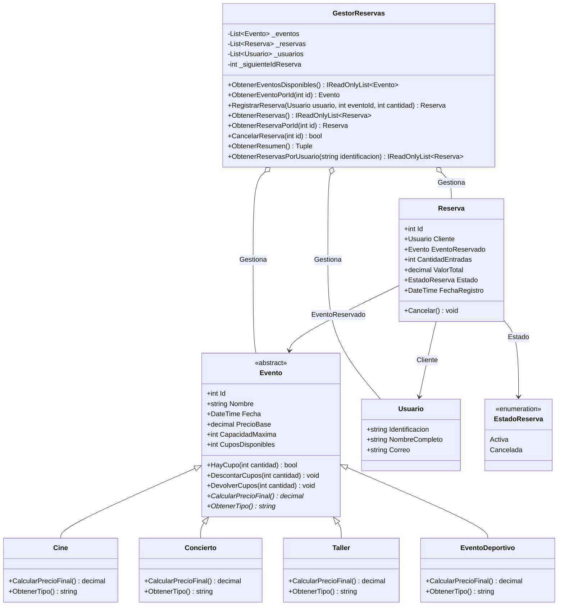
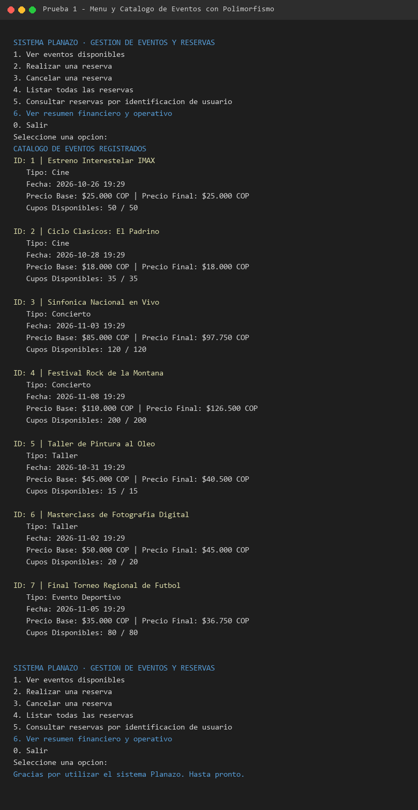
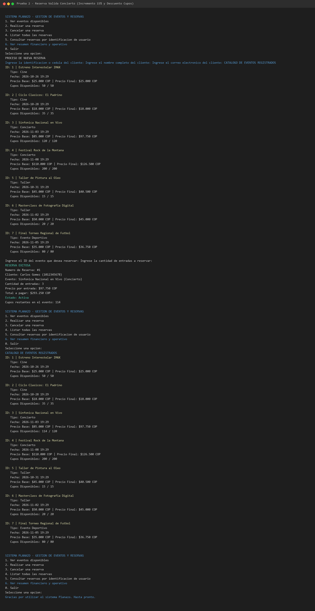
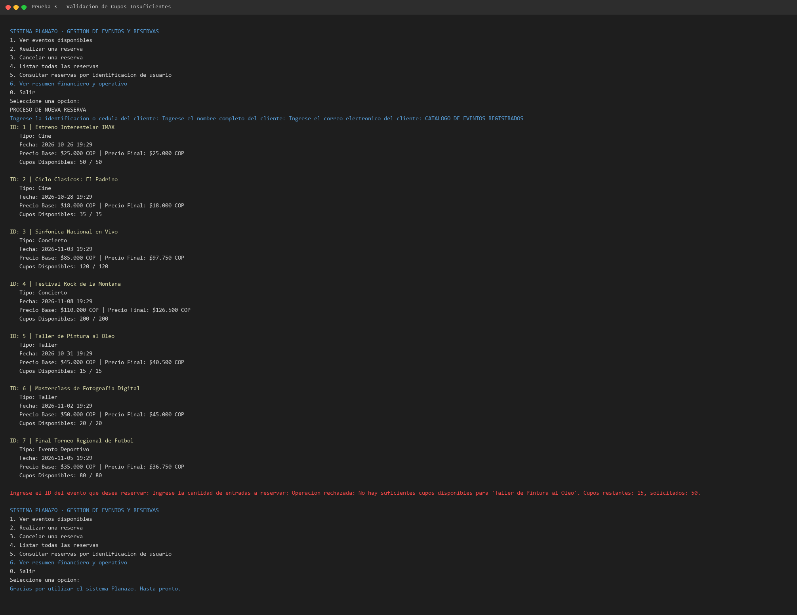
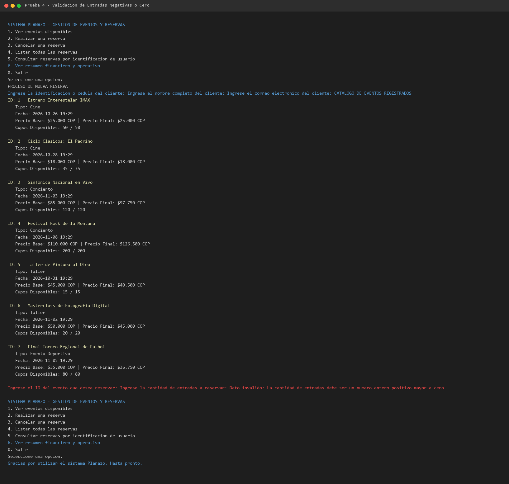
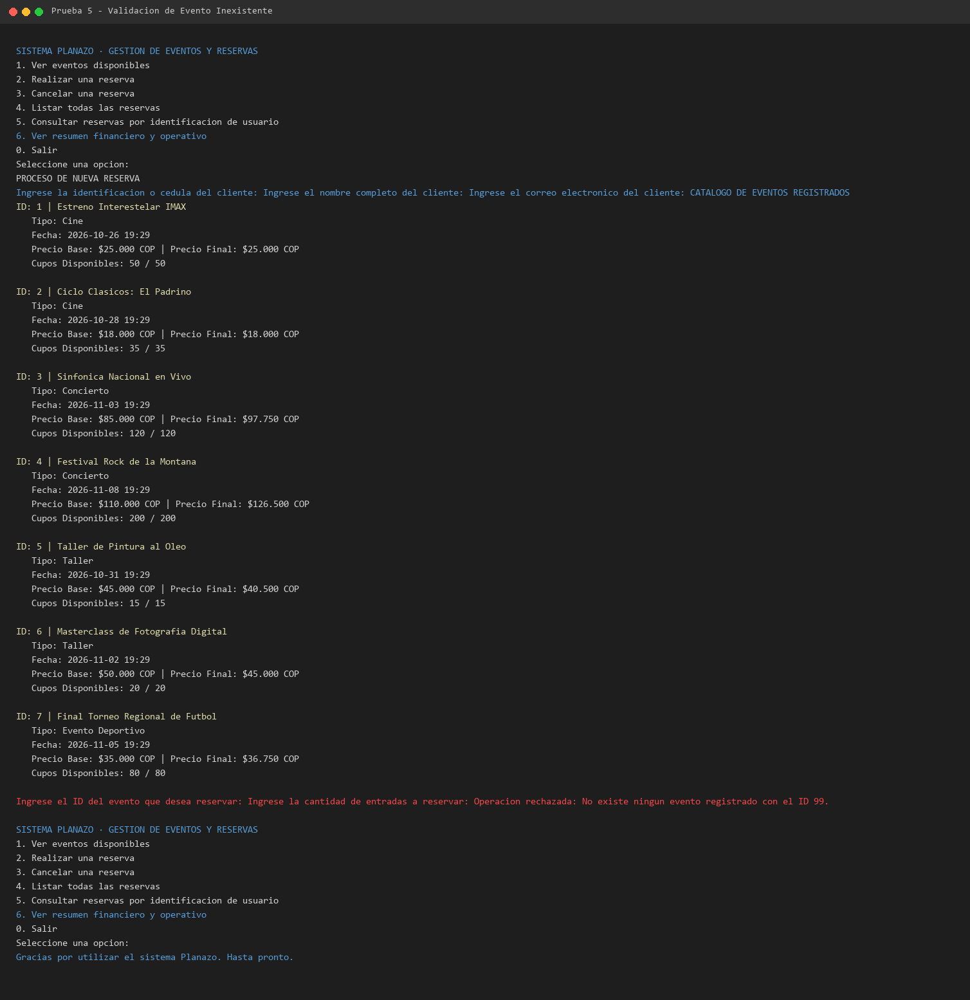
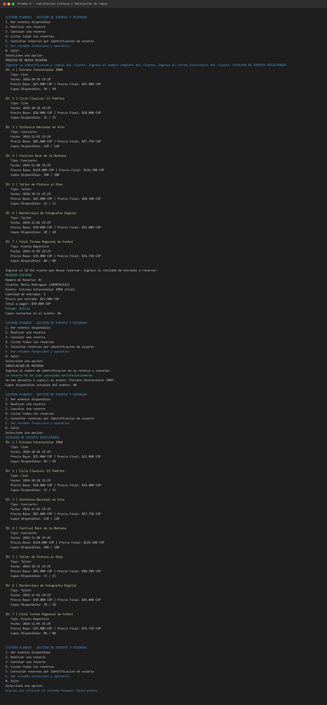
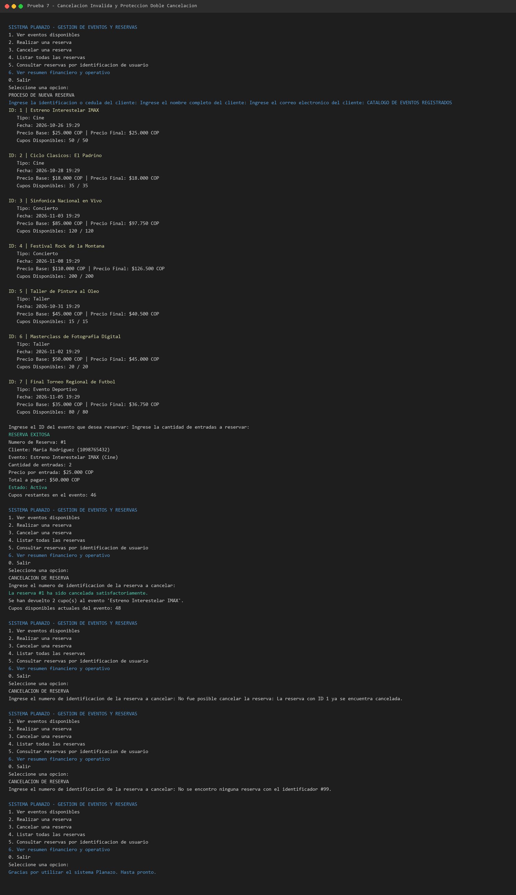
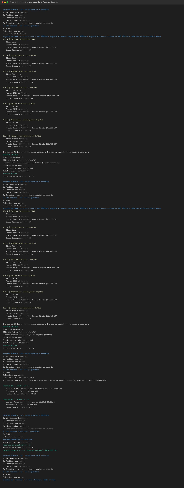

# PLANAZO · Sistema de Gestion de Eventos y Reservas en C# y .NET

PLANAZO es una solucion de consola desarrollada bajo la plataforma .NET 8 y C#, disenada para administrar de forma integral el catalogo de eventos culturales y recreativos, gestionar la disponibilidad de cupos en tiempo real, procesar reservas para usuarios y manejar cancelaciones con reintegro automatico de inventario.

El diseno arquitectonico se fundamenta en los principios de la Programacion Orientada a Objetos (POO), garantizando alta cohesion, bajo acoplamiento, proteccion del estado interno mediante encapsulamiento y extensibilidad a traves del polimorfismo.

## Requisitos y Ejecucion

### Requisitos previos
* SDK de .NET 8.0 o superior instalado en el equipo.

### Instrucciones para compilar y ejecutar
1. Abrir una terminal en la raiz de la carpeta del proyecto `PLANAZO-POO-CSharp`.
2. Restaurar dependencias y compilar:
```bash
dotnet build
```
3. Ejecutar la aplicacion:
```bash
dotnet run
```

## Estructura del Proyecto

El codigo se encuentra modularizado en capas logicas:

* `Modelos/`
  * `Evento.cs`: Clase base abstracta que centraliza los atributos comunes, la logica de gestion de cupos y define el contrato polimorfico para el calculo de tarifas.
  * `Cine.cs`: Clase derivada que representa funciones de cine (mantiene precio base).
  * `Concierto.cs`: Clase derivada que representa conciertos (+15% sobre precio base).
  * `Taller.cs`: Clase derivada que representa cursos y talleres (-10% de descuento academico).
  * `EventoDeportivo.cs`: Clase derivada que representa encuentros deportivos (+5% sobre precio base). Implementa el Reto Adicional 1.
  * `Usuario.cs`: Modelo que representa a los clientes del sistema con identificacion, nombre y correo electronico. Implementa el Reto Adicional 2.
  * `Reserva.cs`: Entidad que encapsula el contrato de reserva asociando un usuario, un evento, la cantidad de entradas adquiridas, el monto total y el estado de la reserva.
* `Servicios/`
  * `GestorReservas.cs`: Clase de servicio encargada de controlar el ciclo de vida de los eventos y las reservas, aplicando validaciones de negocio y consultas con LINQ.
* `Capturas/`
  * Carpeta con las evidencias graficas de ejecucion correspondientes a las pruebas obligatorias y retos adicionales.
* `Program.cs`: Interfaz de usuario interactiva por consola con menu navegable y gestion robusta de excepciones.
* `PLANAZO-POO-CSharp.csproj`: Archivo de configuracion del proyecto .NET.

## Conceptos de POO Implementados

### 1. Encapsulamiento
Cada clase protege estrictamente sus campos internos mediante visibilidad privada (`private`) o protegida (`protected`). El acceso y modificacion se realiza a traves de propiedades con getters publicos y setters privados (`private set`). Por ejemplo, en `Evento`, la propiedad `CuposDisponibles` no puede ser alterada arbitrariamente desde el exterior; unicamente se modifica mediante los metodos controlados `DescontarCupos()` y `DevolverCupos()`, los cuales validan previamente que existan cupos suficientes y que no se superen los limites permitidos.

### 2. Abstraccion
La clase `Evento` es abstracta, lo que impide que sea instanciada directamente, ya que un "evento generico" carece de sentido en el dominio del negocio. Define los metodos abstractos `CalcularPrecioFinal()` y `ObtenerTipo()`, obligando a que cada subtipo concreto defina explicitamente su propia dinamica de precios y su denominacion.

### 3. Herencia
Las clases `Cine`, `Concierto`, `Taller` y `EventoDeportivo` heredan de `Evento`. Esta relacion de especializacion permite reutilizar la infraestructura comun (identificador, nombre, fecha, precio base, capacidad maxima y control de cupos) a la vez que cada clase hija aporta su comportamiento especifico mediante constructores que invocan al constructor base (`base(...)`).

### 4. Polimorfismo
El metodo abstracto `CalcularPrecioFinal()` en `Evento` es sobrescrito (`override`) en cada clase derivada:
* **Cine**: Retorna exactamente el `PrecioBase`.
* **Concierto**: Aplica un recargo del 15% (`PrecioBase * 1.15m`).
* **Taller**: Aplica un beneficio de descuento del 10% (`PrecioBase * 0.90m`).
* **EventoDeportivo**: Aplica un incremento operativo del 5% (`PrecioBase * 1.05m`).

El `GestorReservas` y la clase `Reserva` calculan el valor total invocando `evento.CalcularPrecioFinal()` sin necesidad de condicionales `if` o `switch` sobre el tipo de evento, permitiendo resolver la tarifa dinamicamente en tiempo de ejecucion.

### 5. Asociacion y Composicion
La clase `Reserva` establece una asociacion directa con la clase `Usuario` (el titular de la reserva) y con la clase `Evento` (el espectaculo reservado). Asimismo, la clase `GestorReservas` actua como un agregador que mantiene las colecciones activas de la sesion.

### 6. Colecciones y LINQ
Se utilizan listas genericas `List<Evento>`, `List<Reserva>` y `List<Usuario>` para gestionar las entidades en memoria. Se exponen hacia el exterior colecciones de solo lectura (`IReadOnlyList<T>`) para preservar la inmutabilidad de las estructuras internas. Se emplean consultas LINQ (`Where`, `FirstOrDefault`, `Sum`, `Any`, `Count`) para filtrado, busqueda y consolidacion de metricas.

### 7. Manejo de Excepciones
El sistema incorpora validaciones defensivas que lanzan excepciones puntuales ante anomalias:
* `ArgumentNullException`: Cuando se intentan registrar entidades nulas.
* `ArgumentException`: Cuando se proporcionan datos invalidos (por ejemplo, textos vacios o cantidades de entradas menores o iguales a cero).
* `InvalidOperationException`: Cuando se solicitan mas cupos de los disponibles, cuando se consulta un evento inexistente o cuando se intenta cancelar una reserva que ya se encontraba cancelada.

En `Program.cs`, estas excepciones son capturadas en bloques `try-catch`, ofreciendo retroalimentacion clara al usuario e impidiendo que el aplicativo se cierre inesperadamente.

## Diagrama de Clases UML



## Respuesta a la Pregunta de Sustentacion

### Enunciado
Si en un futuro se necesita agregar un nuevo tipo de evento, por ejemplo `ObraDeTeatro`, que tenga un recargo del 8% sobre el precio base:
1. ¿Que clases se modificarian y cuales no?
2. Explica como el diseno aplicado (especialmente el polimorfismo y el principio abierto/cerrado OCP) facilita esta extension sin romper el codigo existente.

### Respuesta Tecnica
Gracias a la aplicacion rigurosa de los conceptos de POO y del Principio Abierto/Cerrado (OCP - Open/Closed Principle), el sistema esta abierto para su extension pero cerrado para su modificacion:

1. **Clases que NO se modificarian**:
   * `Evento`: La clase base no requiere alteracion alguna, ya que su contrato (`CalcularPrecioFinal()`) ya contempla que cada subtipo calcule su valor.
   * `Cine`, `Concierto`, `Taller`, `EventoDeportivo`: Las clases derivadas existentes permanecen intactas.
   * `Reserva`: No sufre ningun cambio. La clase `Reserva` interactua exclusivamente con la abstraccion `Evento` y desconoce la existencia de subtipos especificos. Al calcular el costo total (`CantidadEntradas * EventoReservado.CalcularPrecioFinal()`), la llamada se despacha polimorficamente en tiempo de ejecucion.
   * `Usuario`: Permanece completamente desacoplada de la tipologia de eventos.
   * `GestorReservas` (logica de negocio de reservas): Los metodos `RegistrarReserva`, `CancelarReserva` y `ObtenerResumen` no contienen ninguna estructura condicional acoplada a tipos de eventos.

2. **Clase que se crearia**:
   * Unicamente se crearia una nueva clase `ObraDeTeatro` en la carpeta `Modelos/`, heredando de `Evento` y sobrescribiendo sus dos metodos abstractos:
     * `CalcularPrecioFinal()`: Retornando `PrecioBase * 1.08m`.
     * `ObtenerTipo()`: Retornando `"Obra de Teatro"`.

3. **Punto de instanciacion**:
   * El unico punto donde se referenciaria la nueva clase es en el registro o inicializacion de instancias del catalogo (por ejemplo en `InicializarDatosPrueba()` o cuando se agregue la funcion de registrar nuevos eventos por consola).

4. **Conclusion del diseno**:
   * El polimorfismo dinamico elimina por completo la necesidad de mantener bloques `switch` o cadenas de `if-else` basadas en nombres o categorias. Cualquier nueva modalidad de evento se acopla inmediatamente al ecosistema sin generar efectos secundarios ni riesgo de regresiones en las funcionalidades ya probadas.

## Evidencias de Pruebas y Funcionamiento

A continuacion se presentan las capturas generadas que certifican el cumplimiento de cada requisito funcional y de validacion:

### Prueba 1: Catalogo de Eventos con Polimorfismo
Visualizacion del catalogo inicializado con 7 eventos de cuatro categorias distintas (Cine, Concierto, Taller y Evento Deportivo), evidenciando el calculo polimorfico del precio final segun cada tipo.


### Prueba 2: Reserva Valida de Concierto
Registro exitoso de 3 entradas para un concierto ($85.000 COP base + 15% = $97.750 COP por entrada; total $293.250 COP) y confirmacion del descuento automatico de cupos disponibles.


### Prueba 3: Control de Cupos Insuficientes
Intento de reservar 50 cupos en un taller con disponibilidad maxima de 15 cupos. El sistema rechaza la transaccion mediante excepcion controlada sin alterar los cupos existentes.


### Prueba 4: Validacion de Cantidad Invalida de Entradas
Intento de reservar una cantidad negativa (-5) o cero entradas. La validacion de dominio lanza una excepcion explicativa y detiene la operacion.


### Prueba 5: Consulta y Reserva de Evento Inexistente
Validacion ante un identificador de evento que no forma parte del catalogo (ID 99), informando apropiadamente al usuario sin abortar la ejecucion del programa.


### Prueba 6: Cancelacion Exitosa y Reintegro de Cupos
Cancelacion de una reserva activa existente. El estado de la reserva cambia a "Cancelada" y los cupos reservados son reintegrados de inmediato al evento correspondiente.


### Prueba 7: Cancelacion Invalida y Proteccion contra Doble Cancelacion
Intento de cancelar por segunda vez una reserva previamente cancelada, asi como el intento de cancelar un ID de reserva inexistente, demostrando la proteccion del estado de las entidades.


### Prueba 8: Consulta de Reservas por Usuario y Resumen Financiero
Demostracion del Reto Adicional 2 (busqueda de reservas filtradas por documento de identidad del usuario) y visualizacion del reporte general con discriminacion de reservas activas, canceladas y recaudo efectivo real.

